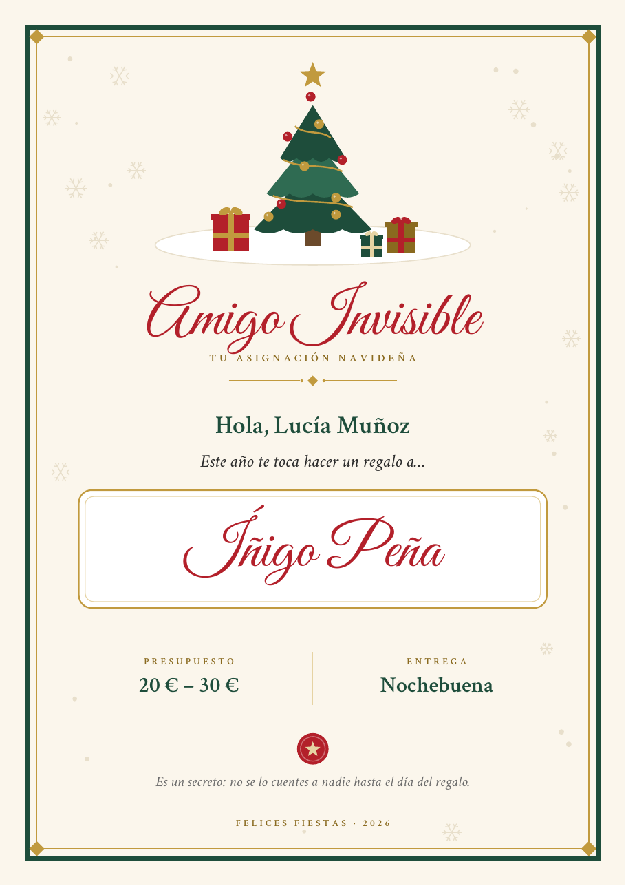

# 🎁 Amigo Invisible

Sortea el Amigo Invisible y envía por correo a cada participante un **PDF navideño** con la persona a la que le toca regalar. Nadie —ni siquiera el organizador— ve quién le toca a quién.

<p align="center">
  
</p>

## Características

- **Sorteo justo**: nadie se toca a sí mismo y el resultado no es predecible (usa la aleatoriedad del sistema operativo).
- **Exclusiones opcionales**: evita que dos personas (parejas, hermanos…) se toquen entre sí.
- **PDF cuidado**, dibujado con vectores y fuentes incluidas que soportan **tildes, eñes y `¡ ¿`**. Se adapta a nombres largos.
- **Credenciales fuera del código**: se leen de un archivo `.env` que Git ignora.
- **Privacidad**: los PDF se crean en una carpeta temporal y se borran al terminar.
- **Modo de prueba** (`--dry-run`) y **vista previa** con nombres ficticios.
- Si falla el envío a alguien, sus datos se conservan para poder reenviárselo.

## Requisitos

Python 3.10 o superior.

## Instalación

```bash
git clone https://github.com/SantiagoRodriguezGSM/Amigo-Invisible.git
cd Amigo-Invisible
python -m venv .venv
source .venv/bin/activate        # En Windows: .venv\Scripts\activate
pip install .
```

## Configuración

### 1. Credenciales y ajustes: `.env`

```bash
cp .env.example .env
```

Edita `.env` y rellena como mínimo `SMTP_USER` y `SMTP_PASSWORD`. Este archivo está en `.gitignore`, así que no se subirá al repositorio. Las demás opciones (presupuesto, fecha de entrega, asunto del correo, servidor SMTP…) están comentadas dentro de `.env.example`.

> **Gmail:** no funciona con tu contraseña habitual. Activa la verificación en dos pasos y crea una
> [contraseña de aplicación](https://myaccount.google.com/apppasswords); esa es la que va en `SMTP_PASSWORD`.
> Con otros proveedores, cambia `SMTP_HOST` y `SMTP_PORT` (465 = SSL, 587 = STARTTLS).

### 2. Participantes: `participants.json`

```bash
cp examples/participants.example.json participants.json
```

```json
[
  { "name": "Lucía Muñoz", "email": "lucia@example.com", "exclude": ["Íñigo Peña"] },
  { "name": "Íñigo Peña",  "email": "inigo@example.com", "exclude": ["Lucía Muñoz"] },
  { "name": "Raúl Núñez",  "email": "raul@example.com" }
]
```

`exclude` es opcional e indica a quién **no** puede tocarle regalar. Es unidireccional: para una pareja, ponlo en las dos entradas. `participants.json` también está en `.gitignore`, porque contiene correos personales.

## Uso

```bash
# 1. Mira cómo queda el PDF (con nombres ficticios)
amigo-invisible preview

# 2. Ensayo general: hace el sorteo y genera los PDF, pero no envía nada
amigo-invisible send --dry-run

# 3. Sorteo y envío real (pide confirmación antes)
amigo-invisible send
```

> ⚠️ Los PDF de `--dry-run` y `--keep-pdfs` **revelan el sorteo**. Bórralos si vas a participar tú también.

| Opción | Descripción |
| --- | --- |
| `-p`, `--participants` | Archivo de participantes (por defecto `participants.json`) |
| `--env-file` | Archivo de configuración (por defecto `.env`) |
| `--dry-run` | No envía correos; guarda los PDF en `--output-dir` |
| `--keep-pdfs` | Conserva los PDF tras enviarlos |
| `-o`, `--output-dir` | Carpeta de los PDF conservados (por defecto `pdfs`) |
| `--delay` | Segundos entre correos (por defecto 3) |
| `-y`, `--yes` | No pedir confirmación |

También puedes ejecutarlo con `python -m amigo_invisible ...`.

## Personalizar el diseño

El PDF se genera en [`src/amigo_invisible/pdf.py`](src/amigo_invisible/pdf.py): la paleta de colores está al principio del archivo y cada elemento (árbol, regalos, marco…) es una función pequeña. Los textos de presupuesto, fecha y año se cambian desde `.env`.

Fuentes incluidas: [Great Vibes](https://fonts.google.com/specimen/Great+Vibes) y [Crimson Text](https://fonts.google.com/specimen/Crimson+Text), bajo licencia [SIL OFL 1.1](src/amigo_invisible/assets/fonts/).

## Desarrollo

```bash
pip install -e ".[dev]"
ruff check .
pytest
```

## Seguridad

- Nunca subas `.env` ni `participants.json`. Si alguna vez publicaste una contraseña, **revócala**: borrarla del código no la elimina del historial de Git.
- Para vulnerabilidades o dudas, abre un *issue* (sin incluir datos personales).

## Licencia

[MIT](LICENSE).
